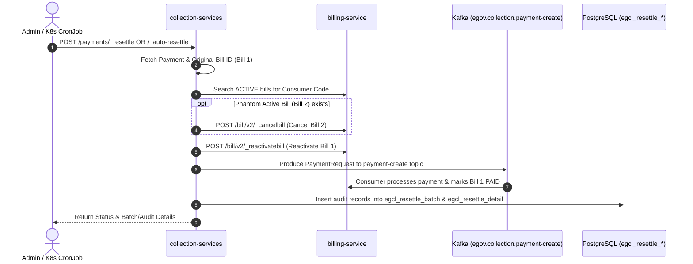

# Collection & Billing Services: Payment Resettlement & Self-Healing Guide

This document provides a comprehensive operational and developer guide for the **Payment Resettlement & Auto-Healing System** across `collection-services` and `billing-service`.

---

## 1. Architecture & Workflow Overview

When a citizen pays against an expired bill (`Bill 1`), `collection-services` successfully issues a receipt. However, `billing-service` historically blocked status updates on expired bills, leaving the bill `EXPIRED` and its associated demands uncollected. Furthermore, subsequent searches auto-generated a phantom active bill (`Bill 2`), causing duplicate billing and dangling references.

The resettlement system resolves this through the following flow:



---

## 2. API Specifications

### API 1: On-Demand Payment Resettlement (`_resettle`)

Used by municipal administrators, helpdesk agents, or citizen self-service to immediately heal a specific stuck payment.

- **Endpoint**: `POST /collection-services/payments/_resettle`
- **Port**: `8280` (Local) / `8080` (K8s Service internal)
- **Headers**: `Content-Type: application/json`

#### Request Parameters

| Parameter | Type | Mandatory | Description |
| :--- | :--- | :--- | :--- |
| `RequestInfo` | Object | **Yes** | Standard DIGIT header with user credentials and tokens |
| `resettleCriteria.tenantId` | String | **Yes** | ULB Tenant ID (e.g., `"pb.amritsar"`) |
| `resettleCriteria.consumerCode` | String | Conditional* | Connection No / Property ID / Application No |
| `resettleCriteria.businessService` | String | Conditional* | Business service code (e.g., `"WS"`, `"SW"`, `"PT"`) |
| `resettleCriteria.receiptNumber` | String | Conditional* | Receipt number from collection |
| `resettleCriteria.paymentId` | String | Conditional* | Unique payment ID (`egcl_payment.id`) |
| `resettleCriteria.billId` | String | Conditional* | Bill ID from billing service |

*\*At least one of `consumerCode`, `receiptNumber`, `paymentId`, or `billId` must be provided.*

#### Complete cURL Command

```bash
curl -X POST "http://localhost:8280/collection-services/payments/_resettle" \
  -H "Content-Type: application/json" \
  -d '{
    "RequestInfo": {
      "apiId": "org.egov.collection",
      "ver": "1.0",
      "ts": 1728988687000,
      "action": "_resettle",
      "did": "1",
      "key": "resettle-key",
      "msgId": "20261014160000|en_IN",
      "authToken": "YOUR_AUTH_TOKEN_HERE",
      "correlationId": "corr-uuid-12345",
      "userInfo": {
        "id": 1,
        "uuid": "40dceade-992d-4a8f-8243-19dda76a4171",
        "userName": "EMPLOYEE_ADMIN",
        "name": "System Admin",
        "mobileNumber": "9876543210",
        "emailId": "admin@punjab.gov.in",
        "type": "EMPLOYEE",
        "tenantId": "pb.amritsar",
        "roles": [
          {
            "id": 1,
            "name": "Super User",
            "code": "SUPERUSER",
            "tenantId": "pb"
          }
        ]
      }
    },
    "resettleCriteria": {
      "tenantId": "pb.amritsar",
      "consumerCode": "WS/107/2021-22/203456",
      "businessService": "WS",
      "receiptNumber": "07/2023-24/001234",
      "paymentId": "PAY-uuid-12345",
      "billId": "BILL-uuid-67890"
    }
  }'
```

#### Sample Response

```json
{
  "ResponseInfo": {
    "apiId": "org.egov.collection",
    "ver": "1.0",
    "ts": 1728988687000,
    "resMsgId": "uief87324",
    "msgId": "20261014160000|en_IN",
    "status": "SUCCESSFUL"
  },
  "resettleStatus": "SUCCESS",
  "originalBillId": "BILL-uuid-67890",
  "cancelledActiveBillId": "BILL-phantom-active-9999",
  "message": "Payment resettlement initiated successfully for Payment ID: PAY-uuid-12345, Original Bill ID: BILL-uuid-67890, Cancelled Phantom Active Bill ID: BILL-phantom-active-9999. Demand and bill settlement event produced to Kafka.",
  "payment": {
    "id": "PAY-uuid-12345",
    "tenantId": "pb.amritsar",
    "totalAmountPaid": 1500.0,
    "paymentStatus": "DEPOSITED"
  }
}
```

---

### API 2: Batch / Automated Resettlement (`_auto-resettle`)

Executed periodically by Kubernetes `CronJob` or triggered manually to find and settle stuck payments within a configurable lookback window.

- **Endpoint**: `POST /collection-services/payments/_auto-resettle`
- **Port**: `8280` (Local) / `8080` (K8s Service internal)
- **Headers**: `Content-Type: application/json`

#### Request Parameters

| Parameter | Type | Default | Description |
| :--- | :--- | :--- | :--- |
| `RequestInfo` | Object | **Yes** | Standard DIGIT header with user credentials |
| `criteria.tenantId` | String | `null` | Target tenant (e.g. `"pb.amritsar"`). If omitted or `"pb"`, scans across all ULBs |
| `criteria.businessService` | String | `null` | Target service (`"WS"`, `"SW"`, `"PT"`). If omitted, scans all services |
| `criteria.bufferMinutes` | Long | `30` | Safety buffer in minutes from `NOW` to avoid in-flight payments |
| `criteria.lookbackHours` | Long | `24` | Number of hours backwards from buffer to search |
| `criteria.fromTime` | Long | Calculated | Epoch millisecond start time (overrides `lookbackHours` if passed) |
| `criteria.toTime` | Long | Calculated | Epoch millisecond end time (overrides `bufferMinutes` if passed) |
| `criteria.limit` | Integer | `50` | Maximum candidate payments to process per batch run |

#### Complete cURL Command

```bash
curl -X POST "http://localhost:8280/collection-services/payments/_auto-resettle" \
  -H "Content-Type: application/json" \
  -d '{
    "RequestInfo": {
      "apiId": "org.egov.collection.cron",
      "ver": "1.0",
      "ts": 1728988687000,
      "action": "_auto-resettle",
      "did": "1",
      "key": "cron-key",
      "msgId": "cron-resettle-20261014",
      "authToken": "YOUR_AUTH_TOKEN_HERE",
      "userInfo": {
        "id": 1,
        "uuid": "cron-system-admin",
        "userName": "CRON_SUPERUSER",
        "type": "SYSTEM",
        "tenantId": "pb",
        "roles": [
          { "id": 1, "name": "Super User", "code": "SUPERUSER", "tenantId": "pb" }
        ]
      }
    },
    "criteria": {
      "tenantId": "pb.amritsar",
      "businessService": "WS",
      "bufferMinutes": 30,
      "lookbackHours": 48,
      "limit": 50
    }
  }'
```

#### Sample Response

```json
{
  "ResponseInfo": {
    "apiId": "org.egov.collection.cron",
    "ver": "1.0",
    "ts": 1728988687000,
    "resMsgId": "uief87325",
    "msgId": "cron-resettle-20261014",
    "status": "SUCCESSFUL"
  },
  "batchId": "b6a71783-cf29-43c2-a9b1-0498b58a183d",
  "totalFound": 5,
  "resettled": 2,
  "skipped": 3,
  "failed": 0,
  "resettledPaymentIds": [
    "PAY-001",
    "PAY-002"
  ],
  "failedPaymentIds": [],
  "messages": [
    "Successfully resettled payment PAY-001 (originalBillId: BILL-001, cancelledActiveBillId: BILL-ACTIVE-002)",
    "Successfully resettled payment PAY-002 (originalBillId: BILL-003)"
  ]
}
```

---

### API 3: Audit & History Query (`_resettle-audit`)

Queries the audit tables without requiring direct database access.

- **Endpoint**: `POST /collection-services/payments/_resettle-audit`
- **Query Parameters**:
  - `batchId`: (Optional) Filter by specific batch execution run ID
  - `paymentId`: (Optional) Filter by payment ID
  - `status`: (Optional) Filter by status (`SETTLED`, `SKIPPED`, `FAILED`)
  - `limit`: (Optional) Page limit (Default `50`)

#### Complete cURL Command

```bash
curl -X POST "http://localhost:8280/collection-services/payments/_resettle-audit?status=FAILED&limit=10" \
  -H "Content-Type: application/json" \
  -d '{
    "RequestInfo": {
      "apiId": "audit-query",
      "ver": "1.0",
      "authToken": "YOUR_AUTH_TOKEN_HERE",
      "userInfo": { "id": 1, "uuid": "admin-user" }
    }
  }'
```

---

## 3. Database Schema

Both tables are managed under Flyway migration script [`V20261013130000__egcl_resettle_audit_tables_ddl.sql`](file:///D:/Upgrade_mSeva/mSevaUPYOG/business-services/collection-services/src/main/resources/db/migration/main/V20261013130000__egcl_resettle_audit_tables_ddl.sql).

### Table 1: `egcl_resettle_batch` (Batch Run Summary)

```sql
CREATE TABLE IF NOT EXISTS egcl_resettle_batch (
    id character varying(64) NOT NULL,
    batch_id character varying(64) NOT NULL,
    tenantid character varying(256),
    businessservice character varying(256),
    from_time bigint,
    to_time bigint,
    total_found integer DEFAULT 0,
    total_settled integer DEFAULT 0,
    total_skipped integer DEFAULT 0,
    total_failed integer DEFAULT 0,
    status character varying(32),
    createdtime bigint,
    createdby character varying(64),
    CONSTRAINT pk_egcl_resettle_batch PRIMARY KEY (id)
);

CREATE INDEX IF NOT EXISTS idx_egcl_resettle_batch_time ON egcl_resettle_batch(createdtime DESC);
CREATE INDEX IF NOT EXISTS idx_egcl_resettle_batch_id ON egcl_resettle_batch(batch_id);
```

### Table 2: `egcl_resettle_detail` (Item Record & Failure Reasons)

```sql
CREATE TABLE IF NOT EXISTS egcl_resettle_detail (
    id character varying(64) NOT NULL,
    batch_id character varying(64),
    paymentid character varying(64) NOT NULL,
    consumercode character varying(256),
    businessservice character varying(256),
    billid character varying(64),
    tenantid character varying(256),
    resettle_status character varying(32),
    failure_reason text,
    createdtime bigint,
    createdby character varying(64),
    CONSTRAINT pk_egcl_resettle_detail PRIMARY KEY (id)
);

CREATE INDEX IF NOT EXISTS idx_egcl_resettle_detail_batch ON egcl_resettle_detail(batch_id);
CREATE INDEX IF NOT EXISTS idx_egcl_resettle_detail_payment ON egcl_resettle_detail(paymentid);
CREATE INDEX IF NOT EXISTS idx_egcl_resettle_detail_status ON egcl_resettle_detail(resettle_status);
```

---

## 4. Production SQL Queries

### Query 1: Find Connections with Receipts against Unsettled / Expired Bills

Use this query in PostgreSQL to identify connections that require resettlement:

```sql
SELECT 
    COALESCE(b.consumercode, clb.consumercode) AS connection_number,
    pyd.businessservice,
    py.tenantid,
    pyd.receiptnumber,
    py.transactionnumber,
    py.totalamountpaid AS receipt_amount,
    to_timestamp(py.createdtime / 1000) AS receipt_date,
    pyd.billid AS bill_id,
    b.status AS bill_status_in_billing,
    COALESCE(SUM(dd.taxamount), 0) AS total_tax_demanded,
    COALESCE(SUM(dd.collectionamount), 0) AS total_collected_amount,
    (COALESCE(SUM(dd.taxamount), 0) - COALESCE(SUM(dd.collectionamount), 0)) AS pending_demand_balance,
    py.id AS payment_id
FROM egcl_payment py
INNER JOIN egcl_paymentdetail pyd ON pyd.paymentid = py.id
INNER JOIN egbs_bill_v1 b ON b.id = pyd.billid
LEFT JOIN egcl_bill clb ON clb.id = pyd.billid
LEFT JOIN egbs_billdetail_v1 bd ON bd.billid = b.id
LEFT JOIN egbs_demand_v1 d ON d.id = bd.demandid
LEFT JOIN egbs_demanddetail_v1 dd ON dd.demandid = d.id
WHERE py.paymentstatus IN ('DEPOSITED', 'NEW')
  AND pyd.receiptnumber IS NOT NULL
  AND (b.status != 'PAID' OR d.ispaymentcompleted = FALSE)
  AND pyd.businessservice IN ('WS', 'SW', 'WS.ONE_TIME_FEE', 'SW.ONE_TIME_FEE')
GROUP BY 
    b.consumercode,
    clb.consumercode,
    pyd.businessservice,
    py.tenantid,
    pyd.receiptnumber,
    py.transactionnumber,
    py.totalamountpaid,
    py.createdtime,
    pyd.billid,
    b.status,
    py.id
HAVING 
    (COALESCE(SUM(dd.taxamount), 0) > COALESCE(SUM(dd.collectionamount), 0))
    OR b.status IN ('EXPIRED', 'ACTIVE')
ORDER BY py.createdtime DESC
LIMIT 5;
```

### Query 2: View Audit Run Summaries

```sql
SELECT 
    batch_id,
    total_found,
    total_settled,
    total_skipped,
    total_failed,
    status,
    to_timestamp(createdtime / 1000) AS run_time
FROM egcl_resettle_batch
ORDER BY createdtime DESC
LIMIT 10;
```

### Query 3: View Granular Settlement Items & Failure Reasons

```sql
SELECT 
    batch_id,
    paymentid,
    consumercode,
    businessservice,
    billid,
    resettle_status,
    failure_reason,
    to_timestamp(createdtime / 1000) AS timestamp
FROM egcl_resettle_detail
ORDER BY createdtime DESC
LIMIT 20;
```

---

## 5. Kubernetes CronJob Operations

The manifest [`collection-resettle-cronjob.yaml`](file:///D:/Upgrade_mSeva/mSevaUPYOG/business-services/collection-services/collection-resettle-cronjob.yaml) is configured to run periodically.

- **Apply CronJob**:
  ```bash
  kubectl apply -f collection-resettle-cronjob.yaml
  ```
- **Inspect CronJobs**:
  ```bash
  kubectl get cronjob -n egov
  ```
- **Trigger immediate manual execution**:
  ```bash
  kubectl create job --from=cronjob/collection-resettle-job test-run-01 -n egov
  ```
- **View logs**:
  ```bash
  kubectl logs -l job-name=test-run-01 -n egov
  ```
